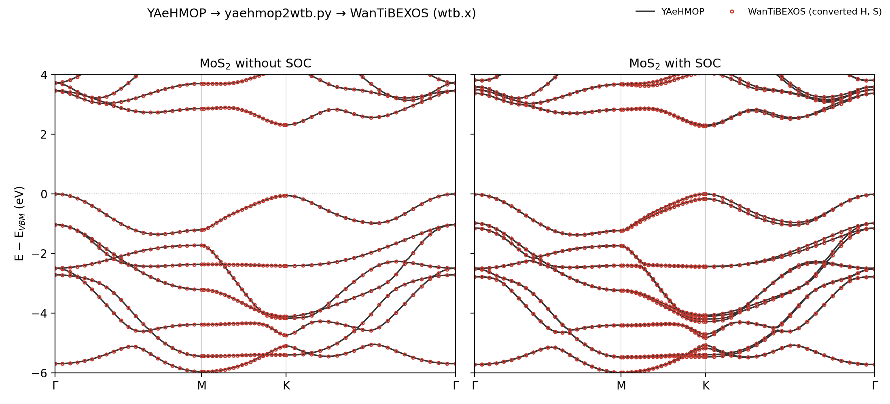

# interface: YAeHMOP H and S → WanTiBEXOS

`yaehmop2wtb.py` reads the Hamiltonian and overlap written by YAeHMOP (`bind` with `Dump Hamil`
and `Dump Overlap`) and writes them in the non-orthogonal tight-binding format of
[WanTiBEXOS](https://github.com/ac-dias/wantibexos), the same layout as `siesta2wtb.py`,
read with `DFT= S`. It handles the three kinds of run (see `docs/SPIN_SOC.md`):

| YAeHMOP run | outputs used | WanTiBEXOS files |
|-------------|--------------|------------------|
| spinless (`bind RUN.bind params.dat`) | `RUN.bind.HAM`, `.OV`, `.out` | `huckel-NP.dat`, `basis_set-NP` |
| SOC (`bind --soc soc.dat RUN.bind params.dat`) | same, with 2n×2n spinor matrices | `huckel-SOC.dat`, `basis_set-SOC` |
| spin polarized (`bind --parm-up ... --parm-down ... RUN.bind`) | `RUN_up.bind.*`, `RUN_down.bind.*` | `huckel-SP.dat`, `basis_set-SP` |

It also writes `input-<TYPE>.dat` and `kpoints.dat` (the band path of `RUN.bind`), ready for
`wtb.x < input-<TYPE>.dat`, and a log `yaehmop2wtb-<TYPE>.log`.

Requirements: Python 3 with numpy and scipy.

## 1. Prepare the YAeHMOP run

The input must contain `Dump Hamil`, `Dump Overlap` and a `K points` block with a
**full Γ-centred mesh** `N1×N2×N3`. YAeHMOP writes H(k) and S(k) at those points, and the
script turns them into H(R), S(R) by an inverse Fourier transform:

    H(R) = (1/N) Σ_k exp(−2πi k·R) H(k),    |R_i| ≤ r_i

YAeHMOP sums the lattice up to `r` cells in each direction (second line of the `Lattice`
section, e.g. `5 5 0`). The transform is therefore **exact** when

- `N_i ≥ 2 r_i + 1` along each periodic direction (11×11×1 for `5 5 0`, 11×11×11 for
  `5 5 5`). With a smaller mesh the script stops; `--allow-aliasing` forces an
  approximate conversion.
- the k points are written with **12 or more decimals** (e.g. `0.090909090909091`).
  YAeHMOP uses them exactly as written, and with 6-8 decimals the rebuilt H(k) is only good
  to ~10⁻⁵-10⁻⁶ eV. The script warns when the points are rounded.

A mesh block can be generated with a few lines of Python:

```python
N = 11
pts = [(i/N, j/N, 0.0) for i in range(N) for j in range(N)]       # 2D; add k/N for 3D
print("K points"); print(len(pts))
for a, b, c in pts: print(f"{a:.15f} {b:.15f} {c:.15f} 1.0")
```

Add a `Band` block too, if you want the script to write the k path for WanTiBEXOS.

## 2. Convert

```
python3 yaehmop2wtb.py path/to/RUN.bind -o wtb_folder [--zero auto|fermi|midgap|<eV>]
```

`RUN.bind` is the input file of the run, with the outputs next to it. The kind of run is
detected from the files: `.SOC` states in the `.out` mean SOC, and `RUN_up`/`RUN_down` files
mean spin polarized. The orbitals of each element come from the `.out` (Extended Hückel
Parameters). The structure, the lattice and the k points come from `RUN.bind`
(crystallographic or Cartesian geometry; `*` atoms with parameters given in the input are
not supported).

The script checks itself: it rebuilds H(k) and S(k) on the mesh from H(R), S(R) (error
~10⁻¹² eV when the conditions above hold). It also checks that H(R) is real (spinless and
spin polarized) and that S(R) is real. The log lists these numbers.

**Energy zero.** `wtb.x` diagonalizes (H(k) − E_F·I, S(k)), which is not a rigid shift
when S ≠ I. The file therefore holds H(R) − E0·S(R) with Fermi level 0, so `wtb.x` gives
exactly the YAeHMOP eigenvalues minus E0. These are the choices for E0:

- `auto` (default): the midgap of the mesh eigenvalues if there is a gap, otherwise the
  Fermi level of the `.out` (`Average Properties` needed);
- `fermi`, `midgap`, or a value in eV.

In a spin-polarized run with `--common-fermi` both channels get the common Fermi level of
`RUN.bind.spin` as zero, so the spin-up and spin-down bands keep their relative position.
In a fixed-moment run (no common Fermi level) each channel uses its own Fermi level, so
that both channels have E_F at 0, as when they were fitted to a DFT calculation with that
moment. SOC with two spin tables (`--soc` with `--parm-up/--parm-down`) writes one spinor
dump and is converted as a SOC run.

**File layout** (as `siesta2wtb.py`): `NP`/`SOC`/`SP`, scissors (0), Fermi level (0),
three lattice vectors [Å], basis size, number of R vectors, a comment line, then one line
`Rx Ry Rz [Å]  i  j  ReH  ImH  S` per element. The basis file has
`index species x y z l m spin`. With SOC and SP the orbitals 1..n are spin up (spin 1)
and n+1..2n spin down (spin −1). In SP the up-down blocks are zero.

## 3. Run WanTiBEXOS

```
cd wtb_folder && mkdir -p out
wtb.x < input-SOC.dat          # bands in out/bands.dat (energies relative to the VBM)
```

## Example: MoS2 monolayer (`example_MoS2/`)

The parametrization is a fit with yaehmop-bandfit (a parameter-fitting tool whose repository
is still private) to FHI-aims HSE06+SOC bands (the same one as `tests/spin_soc/data`). The input `MoS2.bind` has the band path Γ-M-K-Γ (40 points per line)
and the 11×11×1 mesh with 15 decimals. `run_example.sh` does everything:

```
cd example_MoS2
./run_example.sh      # bind (with and without SOC) -> yaehmop2wtb.py -> wtb.x -> compare_bands.py
BIND=/path/to/bind WTB=/path/to/wtb.x ./run_example.sh   # if they are not in the PATH
```

| folder / file | content |
|---------------|---------|
| `MoS2.bind`, `MoS2_params.dat`, `MoS2_soc.dat` | YAeHMOP input, EHT parameters, SOC constants |
| `yaehmop_soc/`, `yaehmop_nosoc/` (made by the script) | YAeHMOP outputs (`.band`, `.HAM`, `.OV`, `.out`, `.SOC`) |
| `wtb_soc/`, `wtb_nosoc/` (made by the script) | converted files (`huckel-*.dat`, `basis_set-*`), `input-*.dat`, `kpoints.dat`, conversion log, `wtb.x` outputs in `out/` |
| `compare_bands.py` | comparison YAeHMOP × WanTiBEXOS, point by point on the same k points |
| `validation.txt`, `bands_yaehmop_vs_wtb.png` | results |

Results (energies relative to the VBM, bands within VBM−6 … VBM+4 eV):

| | without SOC | with SOC |
|---|---|---|
| converted file diagonalized in double precision vs YAeHMOP | 5.4×10⁻⁷ eV | 5.4×10⁻⁷ eV |
| WanTiBEXOS (`wtb.x`) vs YAeHMOP | 4.9×10⁻⁵ eV | 6.6×10⁻⁵ eV |
| band gap, YAeHMOP / WanTiBEXOS | 2.312981 / 2.312991 eV | 2.268108 / 2.268106 eV |
| SOC splitting at K, YAeHMOP / WanTiBEXOS | — | 0.165011 / 0.165014 eV |



The remaining differences come from `wtb.x`, which works in single precision. The converted
file itself reproduces YAeHMOP to 5×10⁻⁷ eV; this is the 8-digit precision of the YAeHMOP
`.band` file. Over all bands the differences reach 10⁻³ eV for `wtb.x`, in states 100 eV or
more above the gap.

**Spin-polarized check (bcc Fe, not included as files).** The Fe fit of
`tests/spin_soc/data` was run on an 11×11×11 mesh and converted to `huckel-SP.dat`. The rebuilt H(k) error was
10⁻¹² eV. `wtb.x` read the SP file and gave the bands of both channels: the double-precision
bands of the file agree with YAeHMOP to 5×10⁻⁷ eV and the `wtb.x` bands to 10⁻³ eV in the window
E_F−8 … E_F+6 eV. The larger `wtb.x` error than in MoS2 comes from single precision with the
nearly singular S(k) of Fe. Far above E_F (4p states at ~5700 eV) single precision fails
completely, which does not affect the bands near E_F.
